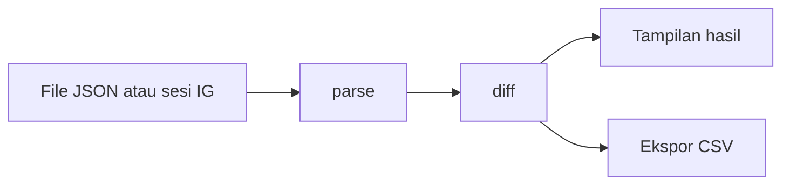

<div align="center">

# Follback Checker

Cek siapa yang tidak follow balik di Instagram, langsung di perangkatmu.<br>
Tanpa server, tanpa akun, tanpa pelacak.

[](LICENSE)
[](packages/core/test/core.test.ts)
[](packages/core)
[](#status)
[](PRIVACY.md)

[Fitur](#fitur) · [Cara pakai](#cara-pakai) · [Privasi](#privasi) · [Arsitektur](#arsitektur) · [Pengembangan](#pengembangan) · [Roadmap](#roadmap)

</div>

---

## Tentang

Follback Checker membandingkan daftar followers dan following Instagram milikmu, lalu menampilkan tiga hal: siapa yang tidak follow balik, siapa yang follow kamu tapi belum kamu follow, dan siapa yang saling follow.

Proyek ini punya dua bentuk yang memakai satu core logic yang sama:

| Bentuk | Cara kerja | Cocok untuk |
|---|---|---|
| **Website** | Drag-drop file JSON dari export resmi Instagram | Siapa saja, tanpa memasang apa pun |
| **Extension browser** | Satu tombol, membaca data lewat sesi login milikmu | Pengecekan cepat tanpa mengunduh export |

Semua pemrosesan terjadi di browser. Tidak ada data yang dikirim ke server mana pun.

## Fitur

- Tiga tampilan hasil: **Tidak follback**, **Fans**, dan **Mutual**
- Pencarian cepat di dalam hasil
- Ekspor ke CSV, dengan perlindungan formula injection untuk spreadsheet
- Mendukung banyak file sekaligus (`followers_1.json`, `followers_2.json`, dan seterusnya)
- Pesan error yang jelas saat format file tidak dikenal
- Tampilan satu field, mode terang dan gelap mengikuti sistem

## Cara pakai

### Website (drag-drop JSON)

1. Di Instagram buka **Pengaturan > Pusat Akun > Informasi dan izin kamu > Unduh informasi kamu**.
2. Pilih **Beberapa informasi kamu**, centang **Followers dan following**, format **JSON**.
3. Setelah file siap, unduh dan ekstrak arsipnya.
4. Seret `followers_1.json` dan `following.json` (dari folder `connections/followers_and_following`) ke kotak di halaman.

> Menu Instagram bisa berubah dari waktu ke waktu. Jika langkah di atas tidak cocok, cari opsi "Download your information".

### Extension

Extension membaca data lewat sesi login Instagram milikmu dengan jeda antar permintaan dan batas maksimum. Ada risiko pembatasan akun dari Instagram jika dipakai berlebihan, jadi jalur JSON tetap disarankan sebagai pilihan utama.

## Privasi

Klaim privasi proyek ini bisa kamu verifikasi sendiri:

- Tidak ada backend, database, akun, atau analytics.
- File dibaca di browser dan hanya disimpan di memori.
- Website memakai Content Security Policy yang memblokir koneksi keluar.
- Extension hanya berbicara dengan `instagram.com`, dan hanya saat kamu menekan tombol.
- Seluruh kode terbuka dan tidak ada dependency runtime pihak ketiga di core.

Selengkapnya ada di [PRIVACY.md](PRIVACY.md).

## Arsitektur

```
.
├── packages/
│   └── core/          Parser, diff, dan ekspor CSV (TypeScript murni)
├── apps/
│   ├── web/           Website statis (Next.js static export)
│   └── extension/     Extension Manifest V3
└── PRIVACY.md
```

Alur data:



Core tidak punya dependency runtime dan tidak melakukan I/O, sehingga mudah diuji dan dipakai ulang oleh website maupun extension.

## Pengembangan

Prasyarat: Node.js 20 atau lebih baru.

```bash
git clone https://github.com/berkatsiallagan/instagram-checker.git
cd instagram-checker
npm install
npm test
```

Contoh memakai core langsung:

```ts
import { parseText, diff } from "@follback/core";

const followers = parseText(followersJsonText);
const following = parseText(followingJsonText);

const { notFollowingBack, fans, mutual } = diff(followers, following);
```

## Status

Proyek sedang dikembangkan. Yang sudah selesai dan yang belum:

| Komponen | Status |
|---|---|
| Core (parser, diff, CSV) dan test | Selesai |
| Website | Belum dimulai |
| Extension | Belum dimulai |

## Roadmap

- [x] Core parser, diff, dan ekspor CSV
- [ ] UI bersama (satu field, tanpa dekorasi)
- [ ] Website statis di Cloudflare Pages
- [ ] Extension mode JSON
- [ ] Extension mode baca langsung dari sesi login
- [ ] Rilis di GitHub Releases, Firefox Add-ons, dan Edge Add-ons

## Kontribusi

Issue dan pull request diterima. Untuk perubahan besar, buka issue dulu supaya arahnya bisa didiskusikan. Pastikan `npm test` lolos sebelum mengirim PR.

## Disclaimer

Proyek ini tidak berafiliasi dengan Instagram atau Meta. Gunakan sesuai ketentuan layanan Instagram dan tanggung jawab sendiri.

## Lisensi

[MIT](LICENSE) &copy; 2026 Berkat Tua Siallagan
