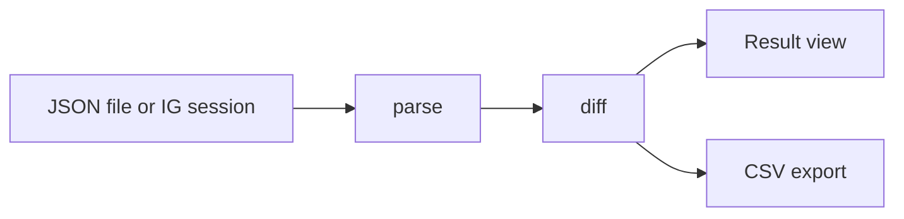

<div align="center">

# Follback Checker

Find out who does not follow you back on Instagram, right on your device.<br>
No server, no account, no tracking.

[](LICENSE)
[](packages/core/test/core.test.ts)
[](packages/core)
[](#status)
[](PRIVACY.md)

**English** · [Bahasa Indonesia](README.id.md)

[Features](#features) · [Usage](#usage) · [Privacy](#privacy) · [Architecture](#architecture) · [Development](#development) · [Roadmap](#roadmap)

</div>

---

## About

Follback Checker compares your Instagram followers and following lists and shows three things: who does not follow you back, who follows you but you do not follow back, and who follows each other with you.

It comes in two forms that share one core logic:

| Form | How it works | Best for |
|---|---|---|
| **Website** | Drag and drop the JSON files from Instagram's official data export | Anyone, nothing to install |
| **Browser extension** | One button, reads data through your own logged-in session | Quick checks without downloading an export |

All processing happens in the browser. No data is sent to any server.

## Features

- Three result views: **Not following back**, **Fans**, and **Mutual**
- Quick search inside results
- CSV export, with spreadsheet formula injection protection
- Multiple files at once (`followers_1.json`, `followers_2.json`, and so on)
- Clear error messages when the file format is not recognized
- Single field interface, light and dark mode follow the system

## Usage

### Website (drag and drop JSON)

1. In Instagram, open **Settings > Accounts Center > Your information and permissions > Download your information**.
2. Choose **Some of your information**, select **Followers and following**, and set the format to **JSON**.
3. When the file is ready, download and extract the archive.
4. Drag `followers_1.json` and `following.json` (from `connections/followers_and_following`) into the box on the page.

> Instagram menus change from time to time. If the steps above do not match, look for the "Download your information" option.

### Extension

The extension reads data through your own logged-in Instagram session, with delays between requests and a hard limit. Instagram may restrict your account if it is used excessively, so the JSON route is recommended as the primary option.

## Privacy

The privacy claims of this project can be verified by anyone:

- No backend, database, account, or analytics.
- Files are read in the browser and kept in memory only.
- The website uses a Content Security Policy that blocks outgoing connections.
- The extension only talks to `instagram.com`, and only when you press the button.
- All code is open, and the core has no third-party runtime dependencies.

More details in [PRIVACY.md](PRIVACY.md).

## Architecture

```
.
├── packages/
│   └── core/          Parser, diff, and CSV export (plain TypeScript)
├── apps/
│   ├── web/           Static website (Next.js static export)
│   └── extension/     Manifest V3 extension
└── PRIVACY.md
```

Data flow:



The core has no runtime dependencies and performs no I/O, which makes it easy to test and reuse in both the website and the extension.

## Development

Requirements: Node.js 20 or newer.

```bash
git clone https://github.com/berkatsiallagan/instagram-checker.git
cd instagram-checker
npm install
npm test
```

Using the core directly:

```ts
import { parseText, diff } from "@follback/core";

const followers = parseText(followersJsonText);
const following = parseText(followingJsonText);

const { notFollowingBack, fans, mutual } = diff(followers, following);
```

## Status

The project is under development. What is done and what is not:

| Component | Status |
|---|---|
| Core (parser, diff, CSV) and tests | Done |
| Website | Not started |
| Extension | Not started |

## Roadmap

- [x] Core parser, diff, and CSV export
- [ ] Shared UI (single field, no decoration)
- [ ] Static website on Cloudflare Pages
- [ ] Extension, JSON mode
- [ ] Extension, direct read from logged-in session
- [ ] Release on GitHub Releases, Firefox Add-ons, and Edge Add-ons

## Contributing

Issues and pull requests are welcome. For large changes, open an issue first so the direction can be discussed. Make sure `npm test` passes before sending a PR. Translations of this README are also welcome.

## Disclaimer

This project is not affiliated with Instagram or Meta. Use it according to Instagram's terms of service and at your own responsibility.

## License

[MIT](LICENSE) &copy; 2026 Berkat Tua Siallagan
