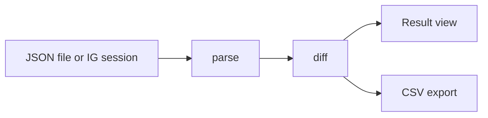

<div align="center">

# Follback Checker

Find out who does not follow you back on Instagram, right on your device.<br>
Cek siapa yang tidak follow balik di Instagram, langsung di perangkatmu.

[](LICENSE)
[](packages/core/test/core.test.ts)
[](packages/core)
[](#status)
[](PRIVACY.md)

No server, no account, no tracking. / Tanpa server, tanpa akun, tanpa pelacak.

</div>

---

<details open>
<summary><b>English</b></summary>

## About

Follback Checker compares your Instagram followers and following lists and shows three things: who does not follow you back, who follows you but you do not follow back, and who follows each other with you.

It comes in two forms that share one core logic:

| Form | How it works | Best for |
|---|---|---|
| **Website** | Drag and drop the JSON files from Instagram's official data export | Anyone, nothing to install |
| **Browser extension** | One button, reads data through your own logged-in session | Quick checks without downloading an export |

All processing happens in the browser. No data is sent to any server.

## Features

- Three result views: **Not following back**, **Fans**, and **Mutual**
- Quick search inside results
- CSV export, with spreadsheet formula injection protection
- Multiple files at once (`followers_1.json`, `followers_2.json`, and so on)
- Clear error messages when the file format is not recognized
- Single field interface, light and dark mode follow the system

## Usage

### Website (drag and drop JSON)

1. In Instagram, open **Settings > Accounts Center > Your information and permissions > Download your information**.
2. Choose **Some of your information**, select **Followers and following**, and set the format to **JSON**.
3. When the file is ready, download and extract the archive.
4. Drag `followers_1.json` and `following.json` (from `connections/followers_and_following`) into the box on the page.

> Instagram menus change from time to time. If the steps above do not match, look for the "Download your information" option.

### Extension

The extension reads data through your own logged-in Instagram session, with delays between requests and a hard limit. Instagram may restrict your account if it is used excessively, so the JSON route is recommended as the primary option.

## Privacy

- No backend, database, account, or analytics.
- Files are read in the browser and kept in memory only.
- The website uses a Content Security Policy that blocks outgoing connections.
- The extension only talks to `instagram.com`, and only when you press the button.
- All code is open, and the core has no third-party runtime dependencies.

More details in [PRIVACY.md](PRIVACY.md).

## Architecture

```
.
├── packages/
│   └── core/          Parser, diff, and CSV export (plain TypeScript)
├── apps/
│   ├── web/           Static website (Next.js static export)
│   └── extension/     Manifest V3 extension
└── PRIVACY.md
```



## Development

Requirements: Node.js 20 or newer.

```bash
git clone https://github.com/berkatsiallagan/instagram-checker.git
cd instagram-checker
npm install
npm test
```

```ts
import { parseText, diff } from "@follback/core";

const followers = parseText(followersJsonText);
const following = parseText(followingJsonText);

const { notFollowingBack, fans, mutual } = diff(followers, following);
```

## Status

| Component | Status |
|---|---|
| Core (parser, diff, CSV) and tests | Done |
| Shared UI and website | Implemented, build not yet verified |
| Extension | Implemented, not yet tested against live Instagram |

## Roadmap

- [x] Core parser, diff, and CSV export
- [x] Shared UI (single field, no decoration)
- [ ] Static website on Cloudflare Pages
- [x] Extension, JSON mode
- [x] Extension, direct read from logged-in session (needs live testing)
- [ ] Release on GitHub Releases, Firefox Add-ons, and Edge Add-ons

## Contributing

Issues and pull requests are welcome. For large changes, open an issue first. Make sure `npm test` passes before sending a PR. Translations are also welcome.

## Disclaimer

This project is not affiliated with Instagram or Meta. Use it according to Instagram's terms of service and at your own responsibility.

</details>

<details>
<summary><b>Bahasa Indonesia</b></summary>

## Tentang

Follback Checker membandingkan daftar followers dan following Instagram milikmu, lalu menampilkan tiga hal: siapa yang tidak follow balik, siapa yang follow kamu tapi belum kamu follow, dan siapa yang saling follow.

Proyek ini punya dua bentuk yang memakai satu core logic yang sama:

| Bentuk | Cara kerja | Cocok untuk |
|---|---|---|
| **Website** | Drag-drop file JSON dari export resmi Instagram | Siapa saja, tanpa memasang apa pun |
| **Extension browser** | Satu tombol, membaca data lewat sesi login milikmu | Pengecekan cepat tanpa mengunduh export |

Semua pemrosesan terjadi di browser. Tidak ada data yang dikirim ke server mana pun.

## Fitur

- Tiga tampilan hasil: **Tidak follback**, **Fans**, dan **Mutual**
- Pencarian cepat di dalam hasil
- Ekspor ke CSV, dengan perlindungan formula injection untuk spreadsheet
- Mendukung banyak file sekaligus (`followers_1.json`, `followers_2.json`, dan seterusnya)
- Pesan error yang jelas saat format file tidak dikenal
- Tampilan satu field, mode terang dan gelap mengikuti sistem

## Cara pakai

### Website (drag-drop JSON)

1. Di Instagram buka **Pengaturan > Pusat Akun > Informasi dan izin kamu > Unduh informasi kamu**.
2. Pilih **Beberapa informasi kamu**, centang **Followers dan following**, format **JSON**.
3. Setelah file siap, unduh dan ekstrak arsipnya.
4. Seret `followers_1.json` dan `following.json` (dari folder `connections/followers_and_following`) ke kotak di halaman.

> Menu Instagram bisa berubah dari waktu ke waktu. Jika langkah di atas tidak cocok, cari opsi "Download your information".

### Extension

Extension membaca data lewat sesi login Instagram milikmu dengan jeda antar permintaan dan batas maksimum. Ada risiko pembatasan akun dari Instagram jika dipakai berlebihan, jadi jalur JSON tetap disarankan sebagai pilihan utama.

## Privasi

- Tidak ada backend, database, akun, atau analytics.
- File dibaca di browser dan hanya disimpan di memori.
- Website memakai Content Security Policy yang memblokir koneksi keluar.
- Extension hanya berbicara dengan `instagram.com`, dan hanya saat kamu menekan tombol.
- Seluruh kode terbuka dan tidak ada dependency runtime pihak ketiga di core.

Selengkapnya ada di [PRIVACY.md](PRIVACY.md).

## Arsitektur

Struktur repo dan alur data sama dengan versi English di atas. Core tidak punya dependency runtime dan tidak melakukan I/O, sehingga mudah diuji dan dipakai ulang oleh website maupun extension.

## Pengembangan

Prasyarat: Node.js 20 atau lebih baru.

```bash
git clone https://github.com/berkatsiallagan/instagram-checker.git
cd instagram-checker
npm install
npm test
```

## Status

| Komponen | Status |
|---|---|
| Core (parser, diff, CSV) dan test | Selesai |
| UI bersama dan website | Sudah ditulis, build belum diverifikasi |
| Extension | Sudah ditulis, belum diuji ke Instagram asli |

## Roadmap

- [x] Core parser, diff, dan ekspor CSV
- [x] UI bersama (satu field, tanpa dekorasi)
- [ ] Website statis di Cloudflare Pages
- [x] Extension mode JSON
- [x] Extension mode baca langsung dari sesi login (perlu diuji langsung)
- [ ] Rilis di GitHub Releases, Firefox Add-ons, dan Edge Add-ons

## Kontribusi

Issue dan pull request diterima. Untuk perubahan besar, buka issue dulu. Pastikan `npm test` lolos sebelum mengirim PR. Terjemahan ke bahasa lain juga diterima.

## Disclaimer

Proyek ini tidak berafiliasi dengan Instagram atau Meta. Gunakan sesuai ketentuan layanan Instagram dan tanggung jawab sendiri.

</details>

---

<div align="center">

[MIT](LICENSE) &copy; 2026 Berkat Tua Siallagan

</div>
