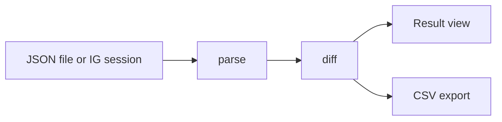

<div align="center">

# Instagram Checker

Find out who does not follow you back on Instagram, right on your device.<br>
Cek siapa yang tidak follow balik di Instagram, langsung di perangkatmu.

[](https://ig.berkatsiallagan.com/)
[](LICENSE)
[](tests/slop.test.ts)
[](packages/core)
[](https://github.com/berkatsiallagan/instagram-checker/releases)
[](PRIVACY.md)

No server, no account, no tracking. / Tanpa server, tanpa akun, tanpa pelacak.

**[Try the Web App](https://ig.berkatsiallagan.com/)** | **[Download Extension (Chrome / Edge / Brave .zip)](https://github.com/berkatsiallagan/instagram-checker/releases/latest/download/instagram-checker-chrome.zip)** | **[Download Firefox .zip](https://github.com/berkatsiallagan/instagram-checker/releases/latest/download/instagram-checker-firefox.zip)**

**[Coba Versi Web](https://ig.berkatsiallagan.com/)** | **[Unduh Ekstensi Chrome/Edge (.zip)](https://github.com/berkatsiallagan/instagram-checker/releases/latest/download/instagram-checker-chrome.zip)** | **[Unduh Ekstensi Firefox (.zip)](https://github.com/berkatsiallagan/instagram-checker/releases/latest/download/instagram-checker-firefox.zip)**

</div>

---

<details open>
<summary><b>English</b></summary>

## About

Instagram Checker compares your Instagram followers and following lists and shows three things: who does not follow you back, who follows you but you do not follow back, and who follows each other with you.

It comes in two forms that share one core logic:

| Form | How it works | Best for |
|---|---|---|
| **Website** | Drag and drop the JSON files from Instagram's official data export | Anyone, nothing to install |
| **Browser extension** | One button, reads data through your own logged-in session | Quick checks without downloading an export |

All processing happens in the browser. No data is sent to any server.

## How to Get Your Instagram JSON Files

1. **Open Settings Menu**
   Go to your Instagram profile, tap the menu icon (three lines) in the top right, and choose **Settings and activity**. Select **Meta Account**, then go to **Your information and permissions**. Tap **Export your information**, then select **Create export**.
2. **Choose Profile and Destination**
   Select your Instagram account from the list. Choose **Export to device** to save the file to your phone or computer.
3. **Customize Data to Export**
   On the confirmation screen, tap **Customise information**. Uncheck all options, then check ONLY **"Followers and following"**. Tap **Save**. *(Optional)* Set **Date range** to **All time**, choose **Format JSON**, and set **Media quality** to **Lower quality** for faster processing.
4. **Start Export and Verify**
   Tap **Start export** at the bottom. Enter your account password for security verification, then tap **Continue**.
5. **Wait and Download File**
   You will receive an email that the export is in progress. Wait until you get the second email saying your file is ready (usually a few minutes). Go back to *Export your information*, find your file under **Available downloads**, and tap **Download**. Tap **Download** again to save it to your device.
6. **Access Your Files**
   The file downloads as a ZIP archive. Open it using a file manager on your phone or extract it on your computer. Drag the `followers_and_following` folder or `followers_1.json` and `following.json` into the upload zone on the website.

## Features

- **Full Relationship Categories:** Displays **Not following back**, **Fans**, **Mutual**, and all 8 Meta connection categories (*Pending requests*, *Recently unfollowed*, *Close friends*, *Blocked*, *Restricted*, *Hide story from*, *Recent requests*, *Dismissed suggestions*).
- **Direct Full Tab Extension:** The extension runs entirely in a dedicated browser tab via background service worker, avoiding accidental closes or losing progress.
- **Cross-Tab Auto Detection:** Automatically communicates with any open `instagram.com` tab in your browser without requiring you to switch tabs.
- **Background Fetch Persistence:** Background fetching continues uninterrupted on the Instagram tab and restores results seamlessly upon return.
- **Interactive Metric Cards:** Click any statistic card to switch directly to that category tab.
- **Instant Unfollow Workflow:** One-click instant unfollow button on the *Not following back* tab that opens the profile and marks it as unfollowed with strikethrough.
- **Hide Unfollowed Filter:** Toggle checkbox to instantly hide accounts you've already unfollowed for clean progress tracking.
- **Copy to Clipboard:** Copy filtered or full username lists directly with a single click.
- **Local Persistence & Privacy:** Analysis state and unfollow progress are automatically restored on next visit via `localStorage`. Never leaves your device.
- **Hybrid Upload:** Drop single JSON files or the whole `followers_and_following` export folder directly.
- **CSV Export:** Clean CSV download protected against spreadsheet formula injection.
- **Legal & Compliance:** Built-in Privacy Policy and Terms of Service ensuring transparency and GDPR/CCPA alignment.

## How to Install the Browser Extension

You can install the extension manually on any desktop browser:

### Chrome / Brave / Opera / Vivaldi
1. Download [instagram-checker-chrome.zip](https://github.com/berkatsiallagan/instagram-checker/releases/latest/download/instagram-checker-chrome.zip) from GitHub Releases.
2. Extract the ZIP file into a folder on your computer.
3. Open `chrome://extensions` in your browser.
4. Turn on **Developer mode** in the top-right corner.
5. Click **Load unpacked** in the top-left and select the extracted folder.
6. Make sure `https://www.instagram.com` is open and logged in in another tab.
7. Click the Instagram Checker icon in your toolbar (pin it from the puzzle menu) to open the full tab, then click **Check**.

### Microsoft Edge
1. Download [instagram-checker-chrome.zip](https://github.com/berkatsiallagan/instagram-checker/releases/latest/download/instagram-checker-chrome.zip) and extract it.
2. Open `edge://extensions` in Microsoft Edge.
3. Turn on **Developer mode** in the left sidebar.
4. Click **Load unpacked** and select the extracted folder.

### Mozilla Firefox
1. Download [instagram-checker-firefox.zip](https://github.com/berkatsiallagan/instagram-checker/releases/latest/download/instagram-checker-firefox.zip).
2. Open `about:debugging#/runtime/this-firefox` in Firefox.
3. Click **Load Temporary Add-on...** and select the ZIP file.

## Privacy

- No backend, database, account, or analytics.
- Files are read in the browser and kept in memory only.
- The website uses a Content Security Policy that blocks outgoing connections.
- The extension only talks to `instagram.com`, and only when you press the button.
- All code is open, and the core has no third-party runtime dependencies.

More details in [PRIVACY.md](PRIVACY.md).

## Architecture

```
.
├── packages/
│   ├── core/          Parser, diff, and CSV export (plain TypeScript)
│   └── ui/            Shared UI components, i18n, and styles
├── apps/
│   ├── web/           Static website (Next.js static export)
│   └── extension/     Manifest V3 extension (Service worker + Full-tab UI + Content script)
├── docs/
│   └── legal/         Privacy Policy, Terms of Service, Cookie Policy
└── PRIVACY.md
```



## Development

Requirements: Node.js 20 or newer.

```bash
git clone https://github.com/berkatsiallagan/instagram-checker.git
cd instagram-checker
npm install
npm test
```

```ts
import { parseText, diff } from "@follback/core";

const followers = parseText(followersJsonText);
const following = parseText(followingJsonText);

const { notFollowingBack, fans, mutual } = diff(followers, following);
```

## Status

| Component | Status |
|---|---|
| Core (parser, diff, CSV) and tests | Done (100% test coverage) |
| Shared UI and website | Live on [ig.berkatsiallagan.com](https://ig.berkatsiallagan.com/) |
| Extension | Built (v0.2.4 available on GitHub Releases) |

## Roadmap

- [x] Core parser, diff, and CSV export
- [x] Shared UI with dual language (ID/EN) and 6-step export guide
- [x] Static website on Cloudflare Pages
- [x] Extension, JSON mode
- [x] Extension, direct read from logged-in session
- [x] Release v0.2.4 on GitHub Releases (Chrome and Firefox zip)
- [ ] Publish to Microsoft Edge Add-ons and Firefox Add-ons

## Contributing

Issues and pull requests are welcome. For large changes, open an issue first. Make sure `npm test` passes before sending a PR. Translations are also welcome.

## Disclaimer

This project is not affiliated with Instagram or Meta. Use it according to Instagram's terms of service and at your own responsibility.

</details>

<details>
<summary><b>Bahasa Indonesia</b></summary>

## Tentang

Instagram Checker membandingkan daftar followers dan following Instagram milikmu, lalu menampilkan tiga hal: siapa yang tidak follow balik, siapa yang follow kamu tapi belum kamu follow, dan siapa yang saling follow.

Proyek ini punya dua bentuk yang memakai satu core logic yang sama:

| Bentuk | Cara kerja | Cocok untuk |
|---|---|---|
| **Website** | Drag-drop file JSON dari export resmi Instagram | Siapa saja, tanpa memasang apa pun |
| **Extension browser** | Satu tombol, membaca data lewat sesi login milikmu | Pengecekan cepat tanpa mengunduh export |

Semua pemrosesan terjadi di browser. Tidak ada data yang dikirim ke server mana pun.

## Cara Mendapatkan File JSON Instagram

1. **Buka Menu Pengaturan**
   Masuk ke profil Instagram Anda, ketuk ikon menu (tiga garis) di kanan atas, lalu pilih **Settings and activity**. Pilih **Meta Account** (Akun Meta), lalu masuk ke **Your information and permissions** (Informasi dan izin Anda). Ketuk **Export your information** (Ekspor informasi Anda), lalu pilih **Create export** (Buat ekspor).
2. **Pilih Profil dan Tujuan**
   Pilih akun Instagram Anda dari daftar profil. Pilih **Export to device** (Ekspor ke perangkat) untuk menyimpan file di HP/komputer Anda.
3. **Atur Data yang Diekspor (Kustomisasi)**
   Pada halaman konfirmasi, ketuk **Customise information** (Kustomisasi informasi). Hapus centang pada semua opsi, lalu **centang hanya pada "Followers and following"**. Ketuk **Save**. *(Opsional)* Atur **Date range** ke **All time** (Sepanjang waktu), pilih **Format JSON**, dan atur **Media quality** ke **Lower quality** (agar proses lebih cepat).
4. **Mulai Ekspor dan Verifikasi**
   Ketuk **Start export** di bagian bawah. Masukkan **password** akun Anda untuk verifikasi keamanan, lalu ketuk **Continue**.
5. **Tunggu dan Unduh File**
   Anda akan menerima email pemberitahuan bahwa proses sedang berjalan. Tunggu hingga Anda menerima email kedua yang menyatakan file **sudah siap** (biasanya hanya butuh beberapa menit). Buka kembali halaman *Export your information*, lalu pada bagian **Available downloads**, ketuk **Download**. Ketuk **Download** sekali lagi pada file yang muncul di layar untuk menyimpannya ke perangkat.
6. **Akses File**
   File akan terunduh dalam format ZIP/JSON. Buka file tersebut menggunakan aplikasi *file manager* di HP atau ekstrak di komputer. Tarik folder `followers_and_following` atau file `followers_1.json` dan `following.json` ke kotak di website.

## Fitur

- **Kategori Relasi Lengkap:** Menampilkan **Tidak follback**, **Fans**, **Mutual**, dan 8 kategori file koneksi Meta (*Permintaan tertunda*, *Baru di-unfollow*, *Teman dekat*, *Diblokir*, *Dibatasi*, *Sembunyikan cerita*, *Permintaan baru*, *Saran dihapus*).
- **Ekstensi Tab Penuh Konsisten:** Ekstensi selalu berjalan langsung di tab browser penuh melalui service worker, tanpa modal popup kecil yang rentan tertutup sendiri.
- **Deteksi Otomatis Lintas Tab:** Otomatis mendeteksi dan berkomunikasi dengan tab `instagram.com` yang sedang terbuka di perambanmu.
- **Ketahanan Proses di Latar Belakang:** Pengambilan data di tab Instagram tetap berjalan lancar dan otomatis memulihkan hasil saat kamu kembali.
- **Kartu Statistik Interaktif:** Klik kartu metrik apa saja untuk langsung beralih ke tab kategori tersebut.
- **Unfollow Instan:** Tombol satu kali klik di tab *Tidak follback* yang langsung membuka profil akun dan menandai status sudah di-unfollow.
- **Sembunyikan Akun Unfollowed:** Toggle centang untuk menyembunyikan akun yang sudah di-unfollow agar daftar tetap rapi dan fokus ke sisa akun.
- **Salin Daftar Username:** Salin daftar username aktif langsung ke clipboard dalam satu klik.
- **Penyimpanan Lokal & Privat:** Hasil analisis dan status unfollow otomatis tersimpan di `localStorage` peramban. Nol data keluar dari perangkatmu.
- **Unggah Hybrid:** Dukung unggah file satuan maupun langsung satu folder `followers_and_following`.
- **Ekspor CSV:** Ekspor data aman dengan sanitasi pencegahan formula injection di Excel/Sheets.
- **Halaman Legal Terintegrasi:** Dilengkapi Kebijakan Privasi (`/privacy`) dan Syarat Ketentuan (`/terms`) yang transparan.

## Cara Pasang Ekstensi di Browser

Kamu bisa memasang ekstensi ini langsung di peramban komputer mana saja:

### Chrome / Brave / Opera / Vivaldi
1. Unduh file [instagram-checker-chrome.zip](https://github.com/berkatsiallagan/instagram-checker/releases/latest/download/instagram-checker-chrome.zip) dari GitHub Releases.
2. Ekstrak file ZIP tersebut ke salah satu folder di komputermu.
3. Buka alamat `chrome://extensions` di browser.
4. Aktifkan saklar **Developer mode (Mode Pengembang)** di pojok kanan atas.
5. Klik tombol **Load unpacked (Muat yang belum dibongkar)** di kiri atas, lalu pilih folder hasil ekstrak tadi.
6. Pastikan tab `https://www.instagram.com` sudah terbuka dan dalam kondisi login di salah satu tab browser.
7. Klik ikon Instagram Checker di toolbar browser (sematkan lewat menu puzzle) untuk membuka tab penuh dan klik **Cek**.

### Microsoft Edge
1. Unduh file [instagram-checker-chrome.zip](https://github.com/berkatsiallagan/instagram-checker/releases/latest/download/instagram-checker-chrome.zip) dan ekstrak filenya.
2. Buka `edge://extensions` di Microsoft Edge.
3. Aktifkan saklar **Developer mode** di menu sisi kiri.
4. Klik tombol **Load unpacked** dan pilih folder hasil ekstrak.

### Mozilla Firefox
1. Unduh file [instagram-checker-firefox.zip](https://github.com/berkatsiallagan/instagram-checker/releases/latest/download/instagram-checker-firefox.zip).
2. Buka `about:debugging#/runtime/this-firefox` di Firefox.
3. Klik **Load Temporary Add-on...** lalu pilih file ZIP tersebut.

## Privasi

- Tidak ada backend, database, akun, atau analytics.
- File dibaca di browser dan hanya disimpan di memori.
- Website memakai Content Security Policy yang memblokir koneksi keluar.
- Extension hanya berbicara dengan `instagram.com`, dan hanya saat kamu menekan tombol.
- Seluruh kode terbuka dan tidak ada dependency runtime pihak ketiga di core.

Selengkapnya ada di [PRIVACY.md](PRIVACY.md).

## Arsitektur

Struktur repo dan alur data sama dengan versi English di atas. Core tidak punya dependency runtime dan tidak melakukan I/O, sehingga mudah diuji dan dipakai ulang oleh website maupun extension.

## Pengembangan

Prasyarat: Node.js 20 atau lebih baru.

```bash
git clone https://github.com/berkatsiallagan/instagram-checker.git
cd instagram-checker
npm install
npm test
```

## Status

| Komponen | Status |
|---|---|
| Core (parser, diff, CSV) dan test | Selesai (100% lolos tes) |
| UI bersama dan website | Aktif di [ig.berkatsiallagan.com](https://ig.berkatsiallagan.com/) |
| Extension | Selesai di-bundle (v0.2.4 tersedia di GitHub Releases) |

## Roadmap

- [x] Core parser, diff, dan ekspor CSV
- [x] UI bersama dengan dual bahasa (ID/EN) dan panduan 6 langkah
- [x] Website statis di Cloudflare Pages
- [x] Extension mode JSON
- [x] Extension mode baca langsung dari sesi login
- [x] Rilis v0.2.4 di GitHub Releases (arsip zip Chrome & Firefox)
- [ ] Rilis di Microsoft Edge Add-ons dan Firefox Add-ons

## Kontribusi

Issue dan pull request diterima. Untuk perubahan besar, buka issue dulu. Pastikan `npm test` lolos sebelum mengirim PR. Terjemahan ke bahasa lain juga diterima.

## Disclaimer

Proyek ini tidak berafiliasi dengan Instagram atau Meta. Gunakan sesuai ketentuan layanan Instagram dan tanggung jawab sendiri.

</details>

---

<div align="center">

Icons: [Google Material Symbols](https://fonts.google.com/icons) (Apache 2.0), inlined as SVG so the app makes no external requests.

[MIT](LICENSE) &copy; 2026 [Berkat Tua Siallagan](https://berkatsiallagan.com)

</div>
